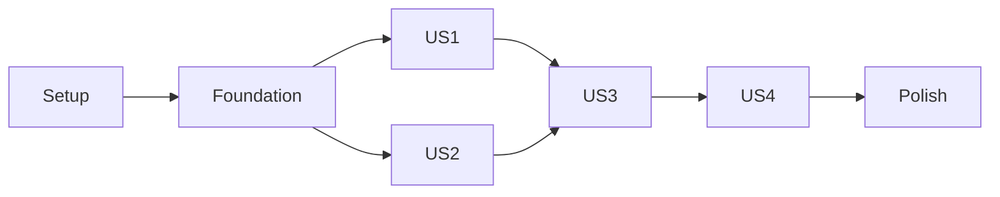

> Historical feature record. Material values, standalone paths and original acceptance plans below describe their own stage, not the current contract. Use the [current retrieval map](../../docs/RAG.md) and shared React sources for new work.

# Tasks: Clasor Frosted Glass

**Input**: [spec.md](spec.md), [plan.md](plan.md), [research.md](research.md), [data-model.md](data-model.md), [contracts/materials.md](contracts/materials.md), [contracts/components.md](contracts/components.md), [quickstart.md](quickstart.md).
**Status**: React integration complete for the latest requested scope; legacy standalone acceptance tasks explicitly deferred by the user.
**Scope**: Original standalone material work followed by shared React integration. No dependency changes, backend or deployment.
**Validation**: Existing commands and manual acceptance checks required by AC1–AC10; no new automated test suite or TDD requested.

## Format and paths

All paths are relative to the owning clasor-new-app repository. [P] indicates file-disjoint work that may run concurrently after its prerequisites. Story labels map to spec.md. Execute shared files sequentially even across stories. Future tasks are unchecked; completing task generation does not complete implementation.

## Phase 1: Setup

Purpose: Establish current-source baseline and a reproducible validation procedure without changing tooling dependencies.

- [x] T001 Inspect clasor-design-system/components.json, index.html, preview.js, tokens.json, reference-overrides.css and scripts/generate-design-tokens.mjs; record actual component count/IDs, stylesheet precedence, current keyboard behavior and standalone assembly method in specs/20261113-172921-frosted-glass-design-system/quickstart.md; preserve unrelated changes and do not invent a missing build script.
- Deferred (user stopped standalone acceptance): T002 Record pre-change npm run tokens:check result and baseline Chromium/Firefox availability, offline font loading and representative screenshots for both HTML variants in specs/20261113-172921-frosted-glass-design-system/quickstart.md; separate existing defects and unavailable environments from glass regressions.

## Phase 2: Foundational — shared material primitives

Purpose: Both hierarchy and coherent identity need compatible tokens, so shared token creation occurs here rather than making US1 depend on completion of US2.

- [x] T003 Add material.chrome.* and material.floating.* scalar tokens in clasor-design-system/tokens.json per contracts/materials.md; preserve existing keys and use only "supported types color(hex6), number, dimension(px), duration(ms), fontFamily, fontWeight"; enforce "alpha [0,1]", "blur px [0,20]" and "saturation [1,1.2]"; include tint, alpha, blur, saturation, highlight color/alpha, border width, shadow color/alpha/x/y/blur/spread and same-type fallback alias; start with chrome .82/16px and floating .92/20px; for both presets set shadowX=0px and shadowSpread=0px as dimension tokens and fallback as a color alias with $value "{color.surface.default}" (existing #FFFFFF), rendered with fill alpha 1 and no backdrop blur while preserving forced-colors precedence.
- [x] T004 Synchronize unprefixed variables in clasor-design-system/tokens.css with T003, run npm run tokens:generate to update lib/design-system/tokens.css, then npm run tokens:check; verify all references resolve without cycles and retain type compatibility, with no generator schema or dependency changes.
- [x] T005 Define token-driven opaque baseline and progressively enhanced material recipes in clasor-design-system/design-system.css; compose fill alpha without container opacity, use @supports for backdrop-filter/prefixed support, preserve opaque text, structural border and elevation; no nested/animated filters or filters on shared page ancestors.

Checkpoint: Tokens resolve, package/consumer variables agree, solid baseline is usable before story work.

## Phase 3: US1 — Understand the material hierarchy (P1, MVP)

Goal: A designer sees glass navigation versus solid reading/editing surfaces. AC1, AC2.

Independent validation: Open index.html offline, inspect every component against its assignment, and confirm one Persian composition shows frosted sidebar/header/menu with solid table, field and long text.

- [x] T006 [P] [US1] Add material assignment and forbidden-nesting metadata for every actual existing component ID in clasor-design-system/components.json; preserve IDs/rules, map navigation to chrome, floating actions to floating, content/forms/dialogs/status to solid, and explain any difference from the planned count of 22.
- [x] T007 [P] [US1] Add one Persian RTL material composition to clasor-design-system/index.html with right sidebar, header toolbar, contextual menu, solid document table, opaque field and long-text example; use local assets and fictional content, retain independent version/approval/access labels, introduce no product route or service behavior.
- [x] T008 [US1] Apply material recipes and responsive composition styling in clasor-design-system/design-system.css and reference-overrides.css after T006–T007; preserve neutral #F8F8F8 canvas, limit lavender tint outside reading areas, keep at most three visible blur regions, use solid menus where blur would nest, and verify no cascade override reintroduces transparent fields/tables.
- Deferred (user stopped standalone acceptance): T009 [US1] Validate the hierarchy in clasor-design-system/index.html against every assignment and composition requirement; record AC1/AC2 findings and screenshots in specs/20261113-172921-frosted-glass-design-system/quickstart.md, correcting material placement within T006–T008 before marking complete.

Checkpoint: Reviewable material MVP; accessibility and distribution acceptance remain separate required increments.

## Phase 4: US2 — Apply a coherent identity (P1)

Goal: Tokens, typography, shape and state identity remain coherent. AC3, AC4.

Independent validation: Compare JSON tokens with both CSS outputs, inspect typography/geometry and action colors in the catalogue, then run tokens:check successfully.

- [x] T010 [P] [US2] Document material token usage, the two CSS naming conventions and initial purple identity in clasor-design-system/REFERENCE_STYLE.md; specify brand #8C66E0, action #8056CB, IRANYekan 400/500/700, current line heights, 32/36/44px controls, 44px touch targets, 16px cards, 20px dialogs and 24px frames; blue remains deferred.
- [x] T011 [P] [US2] Audit and correct identity drift introduced by material recipes in clasor-design-system/design-system.css and reference-overrides.css; preserve solid primary actions, semantic success/error colors, existing inline SVG icon language and logical RTL styling without adding assets/dependencies.
- [x] T012 [US2] Verify clasor-design-system/tokens.json, tokens.css and lib/design-system/tokens.css parity after T011; run npm run tokens:check and record checks of colors, font weights, control/radius values and generated host-token diff in specs/20261113-172921-frosted-glass-design-system/quickstart.md; no application component migration.

Checkpoint: Existing identity and token consumers stay compatible.

## Phase 5: US3 — Work comfortably without effects (P1)

Goal: Readable, keyboard-operable states and opaque fallbacks. AC5, AC6, AC7.

Independent validation: Toggle solid mode, exercise keyboard interactions, emulate supported accessibility media, disable filter support, and measure text/control contrast over all specified background fixtures. Unsupported emulation is a limitation, never a pass.

- [x] T013 [US3] Extend state documentation in clasor-design-system/components.json for "default/hover/pressed/focus-visible/selected/loading/invalid/disabled where applicable"; explicitly mark non-applicable states and preserve readonly, persistent labels, disabled explanations and separate approval/access/version semantics.
- [x] T014 [US3] Add catalogue-only auto/solid control to clasor-design-system/index.html and wire it in preview.js; implement "material auto/solid; session-local default auto" with no account/network persistence, an accessible label/state and no change to existing menu/dialog/file/table interactions.
- [x] T015 [US3] Complete fallbacks in clasor-design-system/design-system.css and reference-overrides.css: "forced colors > explicit solid or reduced transparency > unsupported backdrop-filter > glass"; reduced motion is independent; remove blur/translucency for solid modes, use system colors in forced-colors and preserve system adjustments, focus and selected indicators.
- Deferred (user stopped standalone acceptance): T016 [US3] Refine state styling in clasor-design-system/design-system.css after T013–T015; keep selected distinct from hover, invalid and disabled semantically represented, and non-color cues for selection/errors; ensure loading/disabled controls do not become actionable through material styling.
- Deferred (user stopped standalone acceptance): T017 [US3] Exercise Tab/Shift+Tab, Enter/Space and Escape in clasor-design-system/index.html; check menu clipping, focus containment/return, readonly/disabled/invalid/loading behavior and stacking contexts (sidebar 20, menu 80, toast/skip-link 100); record findings in specs/20261113-172921-frosted-glass-design-system/quickstart.md and fix regressions in their owning HTML/CSS/preview.js before completion.
- Deferred (user stopped standalone acceptance): T018 [US3] Measure actual composited contrast for both material presets and applicable states over the four fixed fixtures defined in specs/20261113-172921-frosted-glass-design-system/quickstart.md (white #FFFFFF, neutral #EBECF0, lavender #F0E9FD, and a top-left-white #FFFFFF/#1D1C22 checkerboard with 16 CSS px squares) in clasor-design-system/index.html; prepare these validation fixtures and follow the paired-capture procedure to measure the minimum ratio beneath each text region against the final composited background after fill alpha and blur, recording sample coordinates and render conditions rather than an average; require normal text >=4.5:1, large text >=3:1 and essential control/focus boundaries >=3:1; Large text means computed font-size >=24 CSS px at any existing weight, or >=18.67 CSS px with the bundled bold weight 700 (18pt regular / approximately 14pt bold). All other text requires >=4.5:1; a heading label alone does not qualify as large text. exercise auto/solid, unsupported filter, reduced transparency, forced colors and reduced motion; record measured values/mode support in specs/20261113-172921-frosted-glass-design-system/quickstart.md and raise alpha or use solid fallback for failures.

Checkpoint: Glass is an enhancement over an independently usable solid interface.

## Phase 6: US4 — Review a portable package (P2)

Goal: Offline parity, responsive delivery and honest evidence. AC8, AC9, AC10.

Independent validation: Both HTML variants work offline in Chromium/Firefox at 360/390/768/1440 with matching material/state behavior, local fonts, no document overflow and recorded limitations.

- [x] T019 [P] [US4] Refresh current v0.3 guidance in clasor-design-system/DESIGN_SYSTEM.md and README.md, preserving v0.1/v0.2 history as historical; explain material placement, opaque fallbacks, offline opening and standalone JSON download-link dependency; do not present prior contrast/QA evidence as new.
- [x] T020 [P] [US4] Reassemble clasor-design-system/clasor-design-system.html using the method established in T001 after US1–US3 stabilize; inline current CSS/JS/local fonts, preserve JSON download links and compare material/state examples with index.html; do not rebuild ds-bundle/.
- Deferred (user stopped standalone acceptance): T021 [US4] Open clasor-design-system/index.html and clasor-design-system.html offline in Chromium and Firefox at widths 360, 390, 768 and 1440; verify local fonts, no missing resources/console regressions, parity of auto/solid mode and keyboard behavior, no document-level horizontal overflow/clipped labels/inaccessible actions (table-local scroll allowed); record results in specs/20261113-172921-frosted-glass-design-system/quickstart.md.
- [x] T022 [US4] Consolidate observed results from T009/T012/T017/T018/T021 into clasor-design-system/validation.json using "viewport, browser, background, mode, component/state, measured contrast, result, evidence, limitation"; include dates/screenshot paths and explicitly mark unavailable checks; do not overwrite historical results with invented passes.

Checkpoint: A portable package and traceable acceptance evidence exist; full completion still requires final checks.

## Phase 7: Polish and cross-cutting verification

- [x] T023 Run npm run tokens:check, npm run lint and npm run build from the owning repository because lib/design-system/tokens.css changes; record commands/results and unrelated baseline failures in specs/20261113-172921-frosted-glass-design-system/quickstart.md; do not add dependencies or an npm test script.
- Deferred (user stopped standalone acceptance): T024 Inspect scroll/menu performance and computed styles in both clasor-design-system/index.html and clasor-design-system.html with a longer representative table; confirm blur <=20px, at most three visible blur regions, no nested/animated filters, no per-row blur and no clipped overlays; record browser/device and observed stutter in clasor-design-system/validation.json without claiming an unmeasured frame budget.
- Deferred (user stopped standalone acceptance): T025 Reconcile remaining failures and documentation contradictions across clasor-design-system/validation.json, DESIGN_SYSTEM.md, REFERENCE_STYLE.md and specs/20261113-172921-frosted-glass-design-system/quickstart.md; after any fixes reassemble standalone HTML and rerun affected checks; record unresolved limitations without marking failed acceptance complete.
- Deferred (user stopped standalone acceptance): T026 Update implementation status and evidence in specs/20261113-172921-frosted-glass-design-system/spec.md, plan.md and tasks.md; rebuild specs/INDEX.md with the existing index updater, check diff whitespace and report changed files, verification and remaining TODO/UNKNOWN; no commit, external artifact edit or publication is implied.

## Dependencies and execution order

Phase 1: T001 → T002.
Phase 2: T003 → T004 → T005, after Phase 1.
US1: (T006 || T007) → T008 → T009, after Phase 2.
US2: (T010 || T011) → T012, after Phase 2; default sequence waits for US1 to avoid concurrent writes to shared CSS and validation guide.
US3: T013 → T014 → T015 → T016 → T017 → T018, after US1 and US2 stabilize.
US4: (T019 || T020) → T021 → T022, after US3.
Polish: T023 → T024 → T025 → T026, after all stories.

US2 can be validated on the existing catalogue after Foundation even if the new composition is not complete. US3 depends on the final surfaces to validate real composites; US4 depends on stable behavior for distribution. These dependencies are explicit rather than claiming every story can run simultaneously.

## Parallel execution examples

- US1: T006 components.json assignment and T007 index.html composition can run together after T005; T008 waits for both.
- US2: T010 REFERENCE_STYLE.md and T011 CSS identity audit can run together after Foundation, with CSS ownership coordinated with US1; T012 waits for both.
- US3: Keep implementation sequential because state, preference and fallback changes share files. An independent read-only keyboard review from T017 and contrast/media review from T018 may run on the same frozen T016 output using separate browsers and separate notes, then one owner merges notes and fixes; neither task has a blanket [P] marker.
- US4: T019 package documentation and T020 standalone assembly can run together after US3; neither edits the other's source files.
- No task generation step automatically dispatches agents.

## Acceptance traceability

| Criterion | Tasks |
| --- | --- |
| AC1 | T006, T008, T009 |
| AC2 | T007–T009 |
| AC3 | T003, T010–T012 |
| AC4 | T003–T005, T012, T023 |
| AC5 | T016, T018 |
| AC6 | T013, T016, T017 |
| AC7 | T014, T015, T018 |
| AC8 | T019–T021 |
| AC9 | T008, T021 |
| AC10 | T022, T024–T026 |

## Implementation strategy

Start with Setup/Foundation and US1 for a local visual MVP. Validate hierarchy before expanding state/fallback handling. US2 confirms identity; US3 is required before declaring the design accessible/ready; US4 delivers portable parity. No MVP milestone implies public release.

Use tasks.md as the implementation checklist; plan.md's six-item outline remains historical planning context. After each coherent unit, record actual checks and mark only completed tasks. Final acceptance requires all AC checks or an explicit documented unresolved limitation; limitations must not be silently counted as passes.

## Historical task-generation snapshot

26 unchecked tasks: Setup 2, Foundation 3, US1 4, US2 3, US3 6, US4 4, Polish 4. Six [P] tasks form three file-disjoint pairs. Each story has an independent validation criterion, every AC has task coverage, and no runtime work has been executed by generating this list.

Implementation evidence: quickstart.md Implementation run. Unchecked validation tasks remain unverified, not passed. T023 completed by running all commands; lint has existing bundle failures. T026 status updates are recorded, but full reconciliation/index rebuild pending.

## Phase 8: Authorized React integration (current scope)

Earlier unfinished standalone acceptance tasks are deferred by explicit user instruction and retained above as non-checkbox records, never as passed checks. The following checklist governs the requested integration; do not check the historical tasks merely to mark this scope complete.

- [x] T027 Move token/contract/validation sources to lib/design-system and update generation/import consumers.
- [x] T028 Apply shared chrome/floating materials to components/ui primitives and catalogue/workspace/wireframe shells; preserve solid content and semantic states.
- [x] T029 Add a React material showcase and root-level solid preference covering portals in components/design-system.
- [x] T030 Update live component coverage and lib/design-system documentation, packaging and current entry links.
- [x] T031 Verify no active dependency remains, preserve necessary assets, then remove redundant clasor-design-system and obsolete assembly script.
- [x] T032 Run tokens, build, focused lint, existing logic tests and browser smoke checks; record actual limitations in quickstart.md.
- [x] T033 Reconcile current status and rebuild specs/INDEX.md without claiming deferred historical acceptance passed.
